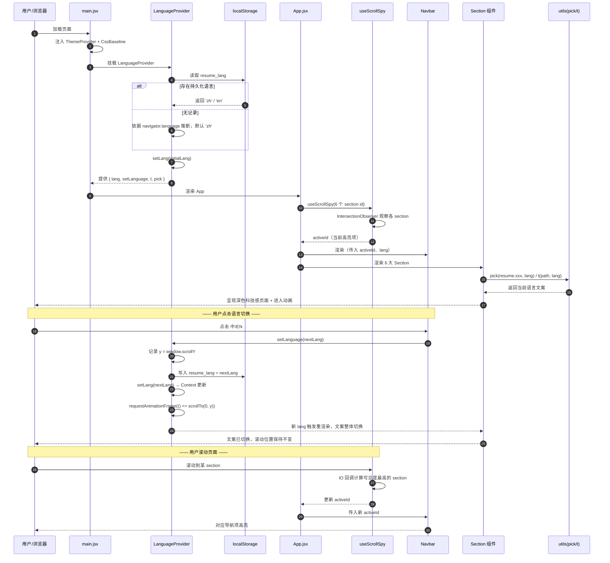
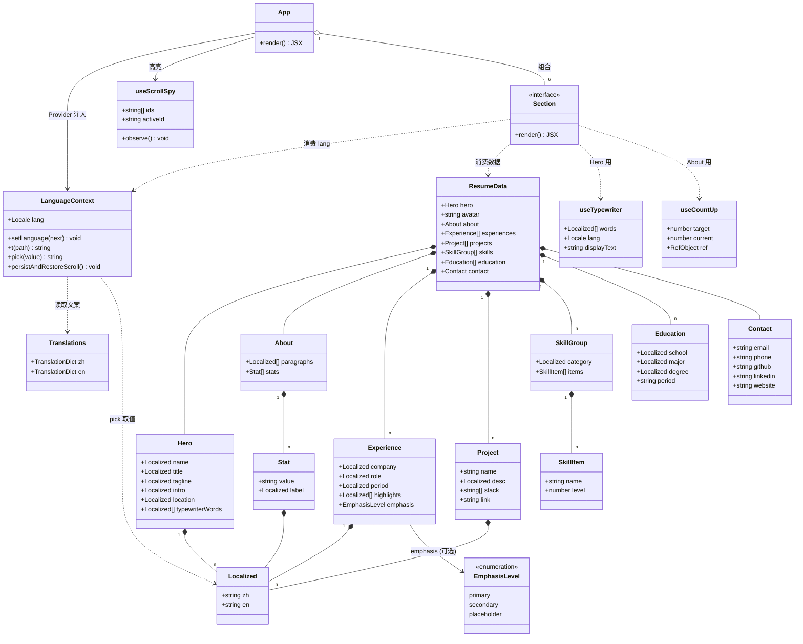
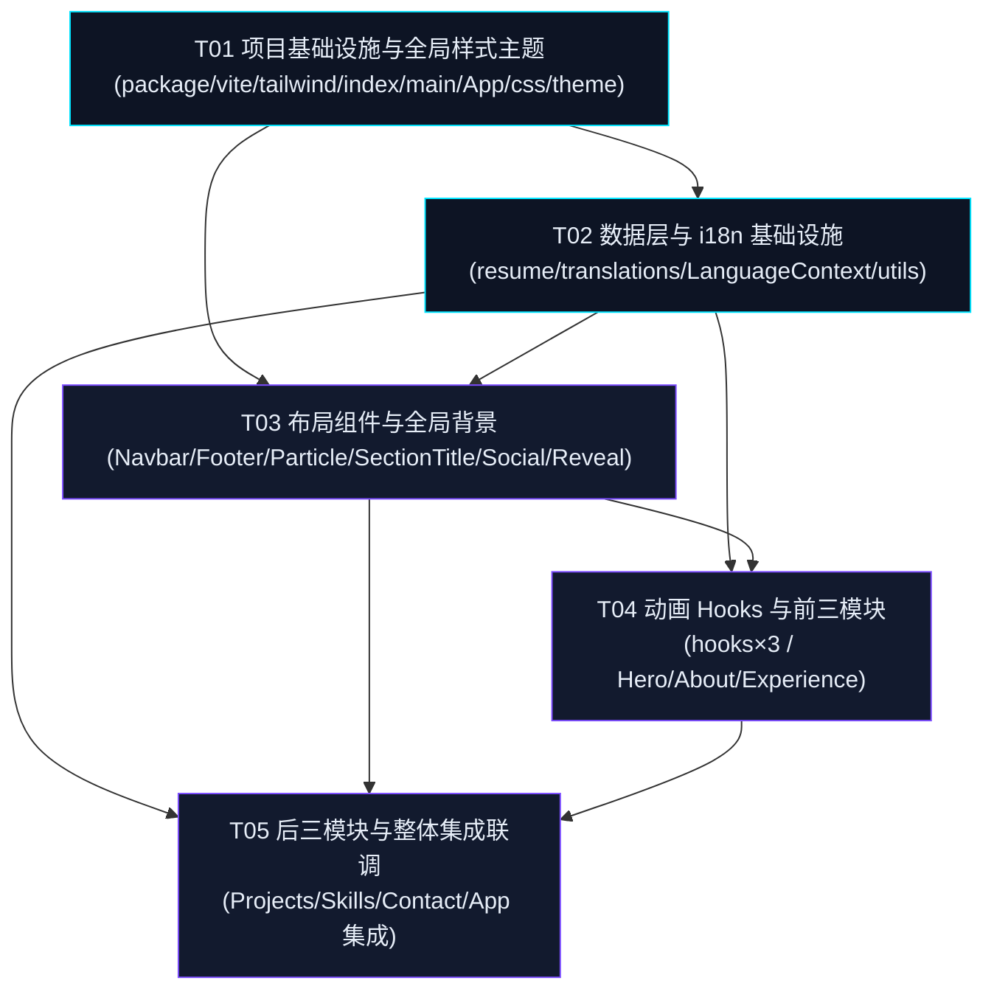

# 个人简历官网 · 系统架构设计与任务分解

| 项 | 内容 |
|---|---|
| 文档版本 | **v1.1**（适配 PRD v2 内容增量，接口向后兼容） |
| 架构师 | 高见远（Gao） |
| 上游输入 | `prd.md` v2.0（产品经理 许清楚） |
| 项目根目录 | `/Users/gaofeng/WorkBuddy/2026-11-21-11-49-26/resume_site` |
| v1.1 变更摘要 | 采纳 PRD v2 两处字段增量：`contact.phone`（必填，空值不渲染）、`experiences[].emphasis`（可选，三级视觉分级）。技术栈 / 6 模块 / 配色 / 动效 / T01–T05 划分均不变 |
| 技术基调 | Vite + React + MUI + Tailwind CSS + Framer Motion |
| 核心约束 | 单页六模块、深色科技感、中英双语、数据单一来源、零成本可部署 |

---

## Part A · 系统设计

## 1. 实现方案与技术选型

### 1.1 核心难点分析

| # | 难点 | 本质 | 应对策略 |
|---|---|---|---|
| D1 | **数据单一来源且中英成对**（R06） | 用户后续只改一个文件即可替换全部真实信息，不能散落文案 | 统一 `Localized = { zh, en }` 结构，全部简历内容收敛到 `src/data/resume.js`；界面固定文案（导航/section 标题）单独放 `src/i18n/translations.js`；组件内**零硬编码文案** |
| D2 | **语言切换不丢失滚动位置**（R04） | setState 触发重渲染可能引起布局跳动与滚动重置 | LanguageContext 切换时记录 `window.scrollY`，在 `requestAnimationFrame` 中恢复；语言状态写入 localStorage 持久化 |
| D3 | **滚动导航高亮**（R03/R12） | 需感知当前视口所在 section | 基于 `IntersectionObserver` 的 `useScrollSpy` hook，观察 6 个 section 的 id，返回 activeId 驱动 Navbar 高亮 |
| D4 | **深色科技感 + 酷炫动效但保证可读性**（R02/R07~R12） | 霓虹光效容易过度、影响性能 | 统一 CSS/主题 token 约束配色；动效统一由 Framer Motion `whileInView` + 自定义 hook 承载；提供 `prefers-reduced-motion` 与移动设备降级 |
| D5 | **零成本构建与部署** | 需构建简单、静态可托管 | 纯前端 SPA，`vite build` 产出静态 `dist/`；无后端、无 SSR、无环境变量依赖；可用 CloudStudio / Vercel / Netlify 静态托管 |
| D6 | **MUI 与 Tailwind 样式冲突** | 两者都带 CSS reset，混用易冲突 | 关闭 Tailwind preflight（`corePlugins.preflight=false`），由 MUI `CssBaseline` 统一重置；分工约定见 §8 |

### 1.2 技术选型与理由

| 领域 | 选型 | 理由 |
|---|---|---|
| 构建工具 | **Vite 5** | 秒级冷启动、配置极简、静态产物天然适配零成本托管；React 官方推荐 |
| UI 框架 | **React 18** | 生态成熟、Context/Hooks 满足状态与动效需求；团队默认栈 |
| 组件库 | **MUI 5** (`@mui/material`) | 提供 Button/Chip/IconButton 等基础组件与主题系统，便于统一深色 palette；`sx` 写动态样式 |
| 样式 | **Tailwind CSS 3.4** | 快速布局/间距/响应式（断点前缀）；与 MUI 分工明确（见 §8） |
| 动效 | **Framer Motion 11** | `motion` + `whileInView` 一行实现滚动进入动画，`AnimatePresence` 处理打字机/切换过渡，声明式易维护 |
| 图标 | **react-icons 5** | 内置 GitHub/LinkedIn 等品牌图标（`FaGithub`/`FaLinkedin`），比 `@mui/icons-material` 品牌图标更全 |
| 粒子背景 | **原生 Canvas 自研**（`ParticleField.jsx`） | 不引入 tsParticles，减少依赖体积与构建复杂度；可控点数、可降级、零成本 |
| 主题/状态 | **React Context + MUI ThemeProvider** | 语言状态用轻 Context 足够（无需 Redux）；主题 token 集中在 `theme.js` |
| 类型表达 | **JS + JSDoc/TS 类型注释** | 默认栈为 JS，工程实现用 `.jsx/.js`；本文档用 TS 语法描述 schema 以保证字段清晰（§3） |

> 结论：坚持团队默认栈，不引入额外重型依赖。粒子用原生 canvas、图标用 react-icons、动效用 Framer Motion，兼顾"酷炫"与"构建简单、零成本部署"。

### 1.3 架构模式

```
分层架构 + 组件化 + Context 状态
┌──────────────────────────────────────────────┐
│  App.jsx（组合层）：导航 + 背景 + 6 Section + 页脚 │
├──────────────────────────────────────────────┤
│  sections/*      业务展示层（6 大模块）          │
│  components/*    复用层（布局/背景/通用组件）     │
├──────────────────────────────────────────────┤
│  hooks/*         行为层（typewriter/countUp/spy）│
│  i18n/*          语言层（Context + 文案包）      │
│  utils/*         工具层（pick/t/scroll/cn）      │
├──────────────────────────────────────────────┤
│  data/resume.js  数据层（唯一数据源，用户替换入口） │
│  theme/theme.js  主题层（配色/字体 token）        │
└──────────────────────────────────────────────┘
```

- **单向数据流**：`resume.js`（数据）+ `translations.js`（文案）→ Context 提供 `lang` → 组件用 `pick()/t()` 取值渲染。
- **关注点分离**：内容（data）、界面文案（i18n）、行为（hooks）、表现（components/sections）彼此解耦。

---

## 2. 文件列表（完整相对路径）

> 路径相对于项目根目录 `resume_site/`。标注 **★** 为用户后续替换真实信息的核心入口。

```
resume_site/
├── index.html                              # HTML 入口：挂载点 #root、页面元信息、字体预连接
├── package.json                            # 依赖声明、脚本(dev/build/preview)、项目元信息
├── vite.config.js                          # Vite 配置：React 插件、base 相对路径、构建输出
├── tailwind.config.js                      # Tailwind 配置：content 扫描、主题色 token 扩展、关闭 preflight
├── postcss.config.js                       # PostCSS 配置：tailwindcss + autoprefixer
├── .gitignore                              # 忽略 node_modules、dist、.DS_Store 等
├── src/
│   ├── main.jsx                            # React 挂载入口：注入 ThemeProvider + CssBaseline + LanguageProvider + 全局样式
│   ├── App.jsx                             # 应用根组件：组装 Navbar/ParticleField/6 Section/Footer，接入滚动高亮
│   ├── index.css                           # 全局样式：CSS 变量、基础重置、scroll-behavior、玻璃态/霓虹工具类
│   ├── data/
│   │   └── resume.js                       # ★ 唯一数据源：全部简历内容中英成对（姓名/经历/项目/技能/教育/联系方式）
│   ├── i18n/
│   │   ├── translations.js                 # 界面固定文案语言包：导航项、section 标题、按钮、滚动提示（zh/en）
│   │   └── LanguageContext.jsx             # 语言 Context+Provider+useLanguage：初始化/切换/localStorage 持久化/滚动位置保持
│   ├── hooks/
│   │   ├── useScrollSpy.js                 # 滚动高亮：IntersectionObserver 观察 section id，返回 activeId
│   │   ├── useTypewriter.js                # 打字机轮播：按词表逐字输入/回退/切换，返回当前显示文本
│   │   └── useCountUp.js                   # 数字增长：进入视口后从 0 计数到目标值，返回当前数值与 ref
│   ├── utils/
│   │   └── common.js                       # 通用工具：pick(双语取值)、t(文案取值)、smoothScrollTo、cn(类名合并)
│   ├── theme/
│   │   └── theme.js                        # MUI 深色主题：palette/字体/组件默认样式（与 CSS 变量、Tailwind 对齐）
│   ├── components/
│   │   ├── layout/
│   │   │   ├── Navbar.jsx                  # 固定顶栏：Logo/姓名、锚点菜单、语言切换、滚动加深、移动端汉堡菜单
│   │   │   └── Footer.jsx                  # 页脚：版权信息（双语）+ 返回顶部按钮
│   │   ├── background/
│   │   │   └── ParticleField.jsx           # Canvas 粒子/流光背景：鼠标轻微交互、低性能/减少动效降级
│   │   └── common/
│   │       ├── SectionTitle.jsx            # section 统一标题：中英标题 + 霓虹装饰线 + 进入动画
│   │       ├── SocialLinks.jsx             # 社交图标组：GitHub/LinkedIn/Email/Website，hover 光效
│   │       └── Reveal.jsx                  # 滚动进入动画包装器：封装 Framer Motion whileInView 的 fade/slide
│   └── sections/
│       ├── HeroSection.jsx                 # ① 首屏 Hero：姓名/头衔/打字机/简介/社交/滚动提示 + 淡入上浮
│       ├── AboutSection.jsx                # ② 关于我：头像视觉块/简介段落/关键数字计数/教育背景
│       ├── ExperienceSection.jsx           # ③ 工作经历：垂直发光时间轴 + 条目依次滑入
│       ├── ProjectsSection.jsx             # ④ 项目作品：响应式卡片网格 + hover 霓虹光晕 + 技术栈标签
│       ├── SkillsSection.jsx               # ⑤ 技能：分组标签云 + 进度条增长动画
│       └── ContactSection.jsx              # ⑥ 联系方式：居中引导语 + 邮箱 CTA 呼吸光效 + 社交图标
```

**文档产物**（本架构师交付）：

```
deliverables/software-company/resume-site/
├── architecture.md                         # 本文档（架构设计 + 任务分解）
├── class-diagram.mermaid                   # 类图（数据结构 + Context/Hook 关系）
└── sequence-diagram.mermaid                # 时序图（启动→渲染→切换→高亮）
```

---

## 3. 数据结构与接口定义

> 设计原则：**所有可替换的简历内容中英成对**，统一用 `Localized = { zh, en }`。专有名词（项目名、技术栈、邮箱、链接）不翻译，用 `string`。此结构完整覆盖 PRD 第 7 节全部字段（映射关系见 §3.4）。

### 3.1 核心类型（TS 语法描述，工程用 JS + JSDoc 落地）

```ts
/** 中英成对文本：覆盖 PRD 中所有 xxx_zh / xxx_en 字段 */
type Localized = { zh: string; en: string };
type Locale = 'zh' | 'en';

/** v2 新增：工作经历内容权重分级（可选，缺省按普通条目渲染，完全向后兼容） */
type EmphasisLevel = 'primary' | 'secondary' | 'placeholder';

interface Stat {          // 关于我 · 关键数字
  value: string;          // '8+' | '30+' | '3'
  label: Localized;       // 年工程经验 / Years of Experience
}

interface SkillItem {     // 单项技能
  name: string;           // 多为专有名词，如 'Python'、'LangChain'
  level?: number;         // 0-100，可选；提供时渲染进度条动画
}

interface SkillGroup {    // 技能分组
  category: Localized;    // 编程语言 / Languages
  items: SkillItem[];
}

interface Experience {     // 工作经历
  company: Localized;      // ShopeeFood / Shopee（v2 真实数据）
  role: Localized;         // 前端开发工程师 / Frontend Engineer
  period: Localized;       // '2024.08 – 2026' / '2024.08 – 2026'
  highlights: Localized[]; // 职责/成果要点列表
  emphasis?: EmphasisLevel;// v2 可选：primary(重点)/secondary(弱化)/placeholder(占位)；缺省=普通条目
}

interface Project {       // 项目作品
  name: string;           // 'AgentFlow'（专有名词不翻译）
  desc: Localized;        // 项目简介
  stack: string[];        // ['Python','Go','LangChain','Kubernetes']
  link: string;           // 'https://github.com/...'
}

interface Education {     // 教育背景（默认合并进"关于我"）
  school: Localized;      // 浙江大学 / Zhejiang University
  major: Localized;       // 计算机科学与技术 / Computer Science & Technology
  degree: Localized;      // 硕士 / Master
  period: string;         // '2016–2019'
}

interface Contact {        // 联系方式
  email: string;
  phone: string;           // v2 必填新增：真实电话，空字符串/缺省时不渲染
  github: string;          // 空字符串时不渲染图标（v2 占位）
  linkedin: string;        // 空字符串时不渲染图标（v2 占位）
  website: string;         // 个人站点/博客；空字符串时不渲染（v2 占位）
}

interface ResumeData {    // ===== src/data/resume.js 的默认导出结构 =====
  hero: {
    name: Localized;
    title: Localized;          // 同时用于打字机轮播首词
    tagline: Localized;
    intro: Localized;
    location: Localized;
    typewriterWords: Localized[]; // 打字机轮播词表
  };
  avatar: string;              // 头像/抽象视觉资源路径，如 '/avatar.svg'
  about: {
    paragraphs: Localized[];   // 关于我简介段落（可多段）
    stats: Stat[];             // 关键数字
  };
  experiences: Experience[];
  projects: Project[];
  skills: SkillGroup[];
  education: Education[];
  contact: Contact;
}
```

### 3.2 `src/data/resume.js` 数据骨架（中英成对，源自 PRD 第 6 节）

```js
/** @type {import('./types').ResumeData} —— 用户只需替换本文件的值 */
export const resume = {
  hero: {
    name:     { zh: '张亦弛', en: 'Yichi Zhang' },
    title:    { zh: '高级 AI Agent 工程师', en: 'Senior AI Agent Engineer' },
    tagline:  { zh: '构建让复杂任务自动运转的智能体系统', en: 'Building agent systems that make complex work run itself' },
    intro:    { zh: '8 年后端与 AI 工程经验，专注 LLM 智能体、RAG 与高并发系统架构', en: '8 years in backend & AI engineering, focused on LLM agents, RAG and high-concurrency systems' },
    location: { zh: '杭州，中国', en: 'Hangzhou, China' },
    typewriterWords: [
      { zh: 'LLM Agents',      en: 'LLM Agents' },
      { zh: 'RAG 系统',         en: 'RAG Systems' },
      { zh: '多智能体编排',      en: 'Multi-Agent Orchestration' },
      { zh: '高并发架构',        en: 'High-Concurrency Architecture' },
    ],
  },
  avatar: '/avatar.svg',
  about: {
    paragraphs: [
      { zh: '……（关于我段落，可多段）', en: '...(about paragraphs)' },
    ],
    stats: [
      { value: '8+',  label: { zh: '年工程经验', en: 'Years of Experience' } },
      { value: '30+', label: { zh: '落地项目',   en: 'Projects Delivered' } },
      { value: '3',   label: { zh: '核心技术领域', en: 'Core Domains' } },
    ],
  },
  experiences: [
    {
      company: { zh: '字节跳动', en: 'ByteDance' },
      role:    { zh: '高级 AI Agent 工程师', en: 'Senior AI Agent Engineer' },
      period:  { zh: '2022.03 – 至今', en: '2022.03 – Present' },
      highlights: [
        { zh: '主导多智能体编排平台，支撑日均百万级任务', en: 'Led multi-agent orchestration platform serving 1M+ daily tasks' },
        { zh: '将 LLM 推理延迟降低 40%', en: 'Reduced LLM inference latency by 40%' },
        { zh: '带领 5 人小组', en: 'Led a team of 5' },
      ],
    },
    // v2：可选 emphasis 字段驱动视觉分级，见 §8.7
    // { ..., emphasis: 'placeholder' } —— 占位（如腾讯音乐，置顶醒目）
    // { ..., emphasis: 'primary' }    —— 重点（如 Shopee 两段，大卡霓虹描边）
    // { ..., emphasis: 'secondary' }  —— 弱化（如实习合并条，紧凑小条）
    // 阿里云 Alibaba Cloud、星尘智能 Starry AI ……（结构相同）
  ],
  projects: [
    {
      name: 'AgentFlow',
      desc:  { zh: '多智能体协作编排平台，支持任务分解、工具调用与可观测性', en: 'Multi-agent collaboration platform with task decomposition, tool use and observability' },
      stack: ['Python', 'Go', 'LangChain', 'Kubernetes'],
      link:  'https://github.com/example/agentflow',
    },
    // NovaRAG / APIX Gateway / AgentHub SDK ……（结构相同）
  ],
  skills: [
    { category: { zh: '编程语言', en: 'Languages' }, items: [
      { name: 'Python', level: 95 }, { name: 'Go', level: 88 }, { name: 'TypeScript', level: 85 }, { name: 'Java', level: 80 },
    ]},
    { category: { zh: 'AI / LLM', en: 'AI / LLM' }, items: [
      { name: 'LLM Agents', level: 92 }, { name: 'RAG', level: 90 }, { name: 'LangChain', level: 88 },
      { name: 'Prompt Engineering', level: 90 }, { name: 'Fine-tuning', level: 78 }, { name: 'Vector Databases', level: 85 },
    ]},
    // 后端/基础设施、云与 DevOps、前端（辅助）……
  ],
  education: [
    { school: { zh: '浙江大学', en: 'Zhejiang University' }, major: { zh: '计算机科学与技术', en: 'Computer Science & Technology' }, degree: { zh: '硕士', en: 'Master' }, period: '2016–2019' },
    { school: { zh: '华中科技大学', en: 'Huazhong University of Science & Technology' }, major: { zh: '软件工程', en: 'Software Engineering' }, degree: { zh: '本科', en: 'Bachelor' }, period: '2012–2016' },
  ],
  contact: {
    email:    'hello@example.com',
    phone:    '', // v2 新增：真实电话；空字符串时不渲染电话入口
    github:   'https://github.com/example', // 空字符串时不渲染图标
    linkedin: 'https://linkedin.com/in/example',
    website:  'https://blog.example.com',
  },
};

export default resume;
```

### 3.3 i18n 语言包 `src/i18n/translations.js`

> 与"数据文件"分工：**数据文件**放用户可替换的简历内容；**语言包**放与用户无关、页面固定的界面文案。组件统一通过 `t(path)` 取值。

```ts
interface TranslationDict {
  nav:      { home; about; experience; projects; skills; contact }; // 导航菜单
  sections: { aboutTitle; aboutSubtitle; experienceTitle; experienceSubtitle;
              projectsTitle; projectsSubtitle; skillsTitle; skillsSubtitle;
              contactTitle; contactLead };                          // section 标题/副标题
  common:   { scrollDown; viewProject; emailMe; backToTop;
              copyright; present; chefNote };                      // 按钮/提示/版权
}
type Translations = Record<Locale, TranslationDict>;
```

```js
export const translations = {
  zh: {
    nav: { home: '首页', about: '关于我', experience: '工作经历', projects: '项目作品', skills: '技能', contact: '联系方式' },
    sections: {
      aboutTitle: '关于我', aboutSubtitle: 'Who I Am',
      experienceTitle: '工作经历', experienceSubtitle: 'Where I Have Been',
      projectsTitle: '项目作品', projectsSubtitle: 'Things I Have Built',
      skillsTitle: '技能栈', skillsSubtitle: 'What I Work With',
      contactTitle: '让我们聊聊', contactLead: '有想法或机会？随时联系我',
    },
    common: { scrollDown: '向下滚动', viewProject: '查看项目', emailMe: '给我发邮件',
              backToTop: '返回顶部', copyright: '© 2026 保留所有权利', present: '至今' },
  },
  en: { /* 一一对应的英文文案 */ },
};
```

### 3.4 PRD 字段映射（第 7 节 → 本结构，确保零遗漏）

| PRD 字段 | 本结构路径 | 语言处理 |
|---|---|---|
| `name_zh/en` | `hero.name` | Localized |
| `title_zh/en` | `hero.title` | Localized |
| `tagline_zh/en` | `hero.tagline` | Localized |
| `intro_zh/en` | `hero.intro` + `about.paragraphs[]` | Localized |
| `location` | `hero.location` | Localized |
| `avatar` | `avatar` | string |
| `stats.*` | `about.stats[]` (`value` + `label`) | value 不变 / label Localized |
| `experiences[].company` | `experiences[].company` | Localized |
| `experiences[].role_zh/en` | `experiences[].role` | Localized |
| `experiences[].period` | `experiences[].period` | Localized |
| `experiences[].highlights_zh/en` | `experiences[].highlights[]` | Localized[] |
| `experiences[].emphasis`（v2 R14 新增） | `experiences[].emphasis` | 可选枚举 `primary`/`secondary`/`placeholder`；缺省=普通条目 |
| `projects[].name` | `projects[].name` | string |
| `projects[].desc_zh/en` | `projects[].desc` | Localized |
| `projects[].stack` | `projects[].stack[]` | string[] |
| `projects[].link` | `projects[].link` | string |
| `skills.*` | `skills[].category` + `skills[].items[]` | 分类 Localized / 技能名 string |
| `education[]` | `education[]` | Localized + period string |
| `contact.email/github/linkedin/website` | `contact.*` | string；空字符串时不渲染 |
| `contact.phone`（v2 R17 新增） | `contact.phone` | string；空字符串/缺省时不渲染电话入口 |

### 3.5 关键 API / 工具函数签名（`src/utils/common.js`）

```ts
pick(value: Localized | string, lang: Locale): string
// 双语文案取值：Localized 取 value[lang]；string 原样返回。组件渲染简历内容统一走它。

t(path: string, lang: Locale): string
// 界面文案取值：从 translations[lang] 按点路径取，如 t('nav.home', lang)。

smoothScrollTo(id: string): void
// 锚点平滑滚动到 section#id（尊重 reduced-motion）。

cn(...classes: Array<string | false | null | undefined>): string
// 轻量类名合并（条件类名）。
```

---

## 4. 程序调用流程

### 4.1 时序图：启动 → 渲染 → 语言切换 → 滚动高亮



### 4.2 类图：数据模型 + Context / Hook 关系



---

## 5. 待明确事项（不阻塞开发）

| # | 事项 | 当前假设（按此推进） | 影响 |
|---|---|---|---|
| A1 | 真实简历内容 | PRD v2 §7.3 已提供高峰真实数据，T02 直接填入；**待补项**（腾讯音乐职位/职责、GitHub/LinkedIn、头像、项目链接、ShopeeFood 截止月份、技能 level 微调）见 PRD v2 §8，到位后仅改 `resume.js` | 仅内容替换，不改结构 |
| A2 | 部署平台 | 默认 CloudStudio 静态托管（`vite build` 产物），备选 Vercel/Netlify；均为免费额度 | 需 QA 阶段确认链接 |
| A3 | 头像资源 | 默认用抽象 SVG 视觉块 `/avatar.svg`（放 `public/`），避免依赖外部图片 | 用户可替换为真实照片 |
| A4 | 教育背景呈现 | 默认合并在"关于我"模块（PRD Q4 建议） | 如需独立 section 后续扩展 |
| A5 | P2 需求（加载动画/雷达图/PDF/统计） | 首版不实现，仅保留数据/结构扩展空间 | 不影响 P0/P1 交付 |
| A6 | 项目链接（v2） | v2 用 `example.com/...` 占位；内部项目若不便公开，按 §8.7(a) 置 `link:''` 隐藏链接按钮 | 需真实链接或确认隐藏 |
| A7 | ShopeeFood 截止月份（v2 Q1） | 数据暂写 `2024.08 – 2026（截至月份待确认）`；腾讯音乐 2026 入职，需用户给准确月份避免时间轴重叠 | 仅改 `resume.js` 的 `period` |

---

## Part B · 任务分解

## 6. 依赖包列表（`package.json`）

**dependencies**

| 包 | 版本 | 用途 |
|---|---|---|
| `react` | `^18.3.1` | UI 框架核心 |
| `react-dom` | `^18.3.1` | React DOM 渲染 |
| `@mui/material` | `^5.16.7` | 组件库 + 主题系统（Button/Chip/IconButton/CssBaseline） |
| `@emotion/react` | `^11.13.3` | MUI 样式引擎（必需 peer 依赖） |
| `@emotion/styled` | `^11.13.0` | MUI 样式引擎（必需 peer 依赖） |
| `@mui/icons-material` | `^5.16.7` | MUI 图标（箭头/菜单/关闭等 UI 图标） |
| `framer-motion` | `^11.11.9` | 滚动进入动画、打字机/切换过渡、hover 微动 |
| `react-icons` | `^5.3.0` | 品牌社交图标（FaGithub/FaLinkedin/FaEnvelope 等） |

**devDependencies**

| 包 | 版本 | 用途 |
|---|---|---|
| `vite` | `^5.4.10` | 构建工具与开发服务器 |
| `@vitejs/plugin-react` | `^4.3.3` | Vite 的 React 快速刷新支持 |
| `tailwindcss` | `^3.4.14` | 原子化 CSS 框架（布局/间距/响应式） |
| `postcss` | `^8.4.47` | Tailwind 所需的 CSS 处理 |
| `autoprefixer` | `^10.4.20` | CSS 浏览器前缀自动补全 |

> **脚本约定**：`dev`（开发）、`build`（`vite build` 产出 `dist/`）、`preview`（本地预览构建产物）。
> **不引入** tsParticles / GSAP / Redux，保持依赖精简、构建简单。

---

## 7. 任务列表（按实现顺序，共 5 个）

> 工程师严格按 T01 → T05 顺序实现。每个任务列出**涉及文件 / 具体工作 / 依赖前置任务**。

### T01 · 项目基础设施与全局样式主题 【P0】

- **涉及文件**（10）：`package.json`、`vite.config.js`、`tailwind.config.js`、`postcss.config.js`、`index.html`、`.gitignore`、`src/main.jsx`、`src/App.jsx`、`src/index.css`、`src/theme/theme.js`
- **具体工作**：
  1. 初始化 Vite+React 项目，声明 §6 全部依赖与 `dev/build/preview` 脚本。
  2. 配置 `vite.config.js`（React 插件、`base: './'` 保证任意路径可部署）。
  3. 配置 Tailwind：`content` 扫描 `index.html` + `src/**/*.{js,jsx}`，扩展 `colors`（cyan/purple/magenta/bg 等 token，映射 §8 色值），**关闭 preflight** 避免与 MUI CssBaseline 冲突。
  4. `index.html`：设置 lang、title、meta description、字体预连接（Inter / 系统中文字体）。
  5. `src/index.css`：定义 CSS 变量（§8）、`html { scroll-behavior: smooth }`、玻璃态/霓虹工具类、`prefers-reduced-motion` 降级。
  6. `src/theme/theme.js`：创建 MUI 深色主题（palette 与 CSS 变量一致、字体、组件默认 props）。
  7. `src/main.jsx`：挂载 `ThemeProvider + CssBaseline + LanguageProvider`（LanguageProvider 暂用占位实现或随 T02 接入），引入 `index.css`。
  8. `src/App.jsx`：搭建骨架布局（Navbar/6 Section/Footer 的占位容器），确保 `npm run dev` 可启动、`npm run build` 可成功。
- **依赖**：无（起始任务）

### T02 · 数据层与 i18n 基础设施 【P0】

- **涉及文件**（4）：`src/data/resume.js`、`src/i18n/translations.js`、`src/i18n/LanguageContext.jsx`、`src/utils/common.js`
- **具体工作**：
  1. 按 §3.2 建立 `src/data/resume.js`，**直接填入 PRD v2 §7.3 的真实简历数据**（高峰/前端工程师/Shopee 经历/真实邮箱电话等，中英成对），字段完整覆盖 §3.4 清单，含 `contact.phone` 与 `experiences[].emphasis`；空占位值（`github`/`linkedin`/`website:''`）按 PRD v2 §8 保留为空字符串，组件侧按 §8.7 隐藏。
  2. 按 §3.3 建立 `translations.js`，导航/section 标题/按钮/提示文案 zh/en 一一对应。
  3. 实现 `LanguageContext.jsx`：`lang` 初始化（localStorage → navigator.language → 默认 zh）、`setLanguage`（记录 `scrollY`、写 localStorage、`setLang`、`rAF` 恢复滚动位置）、`t`/`pick` 便捷方法、`useLanguage` hook。
  4. 实现 `common.js` 的 `pick`/`t`/`smoothScrollTo`/`cn`（见 §3.5 签名）。
  5. 回头在 `src/main.jsx` 用真实的 `LanguageProvider` 替换 T01 的占位。
- **依赖**：T01

### T03 · 布局组件与全局背景 【P0/P1】

- **涉及文件**（6）：`src/components/layout/Navbar.jsx`、`src/components/layout/Footer.jsx`、`src/components/background/ParticleField.jsx`、`src/components/common/SectionTitle.jsx`、`src/components/common/SocialLinks.jsx`、`src/components/common/Reveal.jsx`
- **具体工作**：
  1. `Navbar.jsx`：固定顶部玻璃态导航，Logo/姓名（读 `resume.hero.name`）、6 个锚点菜单（文案 `t('nav.*')`）、右侧中/EN 切换（调 `setLanguage`）、滚动加深、桌面/移动端汉堡菜单（断点 `md`），预留 `activeId` prop 用于高亮。
  2. `Footer.jsx`：版权（`t('common.copyright')`）+ 返回顶部（`smoothScrollTo('home')`）。
  3. `ParticleField.jsx`：canvas 粒子/流光，鼠标轻微交互；低性能/`prefers-reduced-motion`/移动端降低点数或降级为静态渐变。
  4. `SectionTitle.jsx`：中英标题 + 霓虹装饰线，包 `Reveal`。
  5. `SocialLinks.jsx`：从 `resume.contact` 渲染 GitHub/LinkedIn/Email/Website/**电话（`tel:`）**图标（`react-icons`），hover 光效，外链 `target="_blank"`；**空字符串字段跳过渲染**（§8.7），不产生无效链接。
  6. `Reveal.jsx`：封装 Framer Motion `whileInView` 的 fade/slide（含 `once`/`viewport` 配置与 reduced-motion 处理）。
- **依赖**：T01、T02

### T04 · 动画 Hooks 与前三模块（Hero / 关于我 / 工作经历）【P0/P1】

- **涉及文件**（6）：`src/hooks/useTypewriter.js`、`src/hooks/useCountUp.js`、`src/hooks/useScrollSpy.js`、`src/sections/HeroSection.jsx`、`src/sections/AboutSection.jsx`、`src/sections/ExperienceSection.jsx`
- **具体工作**：
  1. `useTypewriter.js`：按 `typewriterWords` + 当前 `lang` 逐字输入/停顿/回退循环，返回显示文本；reduced-motion 时直接显示首词。
  2. `useCountUp.js`：进入视口后数字从 0 增长到 `target`（配合 IntersectionObserver），返回 `current` 与 `ref`。
  3. `useScrollSpy.js`：IntersectionObserver 观察 6 个 section id，返回可见度最高的 `activeId`；供 App 驱动 Navbar 高亮（在 T05 集成）。
  4. `HeroSection.jsx`（`id="home"`）：全屏姓名/头衔/打字机/tagline/intro/location、社交图标、滚动提示、淡入上浮、粒子背景由 App 铺底。
  5. `AboutSection.jsx`（`id="about"`）：头像视觉块、简介段落、`stats` 数字计数动画、教育背景列表（§教育合并）。
  6. `ExperienceSection.jsx`（`id="experience"`）：垂直发光时间轴，条目依次滑入，职位/公司/时间/要点全部双语；**按 `emphasis` 做三级视觉分级渲染**（见 §8.7）：`placeholder` 置顶醒目占位卡（虚线描边+脉冲+"待补充"角标）、`primary` 大卡霓虹描边+highlights 全展开、`secondary` 紧凑小条弱化；缺省按普通条目，完全向后兼容。
  7. 所有 section 用 `useLanguage()` 取 `lang`，用 `pick(resume.xxx, lang)` / `t(path)` 渲染，禁止硬编码文案。
- **依赖**：T02、T03

### T05 · 后三模块与整体集成联调 【P0/P1】

- **涉及文件**（4，其中 `App.jsx` 为修改）：`src/sections/ProjectsSection.jsx`、`src/sections/SkillsSection.jsx`、`src/sections/ContactSection.jsx`、`src/App.jsx`（修改）
- **具体工作**：
  1. `ProjectsSection.jsx`（`id="projects"`）：响应式卡片网格（移动端 1 列/md 2 列/lg 3 列），卡片含项目名/简介/技术栈 Chip/查看链接，hover 霓虹描边 + 上浮，交错淡入。
  2. `SkillsSection.jsx`（`id="skills"`）：分组展示，`level` 存在时渲染进度条进入视口增长动画，否则标签云。
  3. `ContactSection.jsx`（`id="contact"`）：居中引导语、邮箱主 CTA（呼吸光效）、**电话入口（`contact.phone` 非空才渲染，`tel:` 链接）**、社交图标组（空值跳过，见 §8.7）。
  4. `App.jsx` 完整集成：`<ParticleField/>` 铺底 + `<Navbar activeId={...}/>` + 6 个 Section（顺序 home/about/experience/projects/skills/contact）+ `<Footer/>`；接入 `useScrollSpy` 驱动高亮；语言切换全局生效。
  5. 联调收尾：锚点平滑滚动、移动端菜单、语言切换滚动位置保持、动效降级、`npm run build` 通过并本地 `preview` 验证。
- **依赖**：T02、T03、T04

### 任务汇总表

| 任务 | 名称 | 文件数 | 优先级 | 依赖 |
|---|---|---|---|---|
| T01 | 项目基础设施与全局样式主题 | 10 | P0 | — |
| T02 | 数据层与 i18n 基础设施 | 4 | P0 | T01 |
| T03 | 布局组件与全局背景 | 6 | P0/P1 | T01, T02 |
| T04 | 动画 Hooks 与前三模块 | 6 | P0/P1 | T02, T03 |
| T05 | 后三模块与整体集成联调 | 4 | P0/P1 | T02, T03, T04 |

> 符合硬约束：任务数 5（≤5）、每任务 ≥3 文件、T01 为基础设施集中全部配置与入口。

---

## 8. 共享知识（跨文件约定）

### 8.1 命名规范

| 类别 | 规范 | 示例 |
|---|---|---|
| 组件文件/组件名 | PascalCase，文件名与默认导出同名 | `Navbar.jsx` → `Navbar` |
| Hook | `use` 前缀 camelCase | `useScrollSpy.js` → `useScrollSpy` |
| 工具/数据文件 | camelCase | `resume.js`、`translations.js`、`common.js` |
| CSS 变量 | `--` 前缀，短横线分隔 | `--accent-cyan` |
| Section id | 固定小写英文，与导航 key 一致 | `home`/`about`/`experience`/`projects`/`skills`/`contact` |
| 双语字段 | 统一对象 `{ zh, en }`，访问用 `pick()` | `resume.hero.name` |

### 8.2 主题 Token（三处保持一致：`index.css` CSS 变量 / `tailwind.config.js` / `theme.js`）

| 语义 | CSS 变量 | 色值 | Tailwind 配置键 | MUI palette |
|---|---|---|---|---|
| 主背景 | `--bg-base` | `#0A0E1A` | `colors.bg.base` | `background.default` |
| 次背景 | `--bg-deep` | `#0D1424` | `colors.bg.deep` | `background.paper` |
| 卡片 | `--bg-card` | `#121A2E` | `colors.bg.card` | `background.card` |
| 玻璃态 | `--glass` | `rgba(255,255,255,0.04)` | `colors.glass` | — (sx 直接用) |
| 霓虹青 | `--accent-cyan` | `#00E5FF` | `colors.accent.cyan` | `primary.main` |
| 霓虹紫 | `--accent-purple` | `#7C4DFF` | `colors.accent.purple` | `secondary.main` |
| 霓虹品红 | `--accent-magenta` | `#FF2E97` | `colors.accent.magenta` | `error.main` |
| 正文 | `--text-primary` | `#E6EDF7` | `colors.text.primary` | `text.primary` |
| 次要文字 | `--text-secondary` | `#8B9AB3` | `colors.text.secondary` | `text.secondary` |

> 组件样式引用优先级：颜色/字体用 token（CSS 变量或主题），布局/间距/响应式用 Tailwind 类，修正用 `sx`。禁止在组件写死色值。

### 8.3 i18n 用法约定

```jsx
import { useLanguage } from '../i18n/LanguageContext';
import { pick, t } from '../utils/common';
import resume from '../data/resume';

const { lang, setLanguage } = useLanguage();
pick(resume.hero.name, lang);   // 简历内容（成对字段）
t('nav.home', lang);            // 界面固定文案（语言包）
```

- 切换语言走 `setLanguage(next)`，**不要**直接改 `lang`。
- 切换保持滚动位置与持久化的逻辑**只在 LanguageContext 实现一处**，组件不重复处理。

### 8.4 数据访问约定（R06 关键）

- 所有对外展示的简历内容**必须**来自 `src/data/resume.js`；组件内**禁止**出现任何真实人名、公司名、项目描述等硬编码文案。
- 用户替换真实信息时**只改 `resume.js`**（按 §3.4 映射），不改任何组件。
- 界面固定文案来自 `translations.js`，新增文案需同时补 zh/en 两处。

### 8.5 动效与降级策略

- 所有进入动画统一用 `Reveal.jsx` 或 Framer Motion `whileInView`，保持节奏一致（`duration≈0.6s`，`easeOut`）。
- `prefers-reduced-motion: reduce` 时：关闭滚动动画、粒子改静态、打字机直接显示、数字直接显示终值。
- `useScrollSpy`/`useCountUp` 依赖 `IntersectionObserver`，需提供 fallback（无 IO 时默认第一项 / 显示终值）。
- 粒子背景在移动端或低性能设备减少点数，保证首屏可读性与流畅度。

### 8.6 样式共存与响应式

- **关闭 Tailwind preflight，保留 MUI `CssBaseline`** 作为唯一全局重置，避免双重 reset 冲突。
- 分工：Tailwind 负责 flex/grid/间距/宽高/断点前缀（`sm:`/`md:`/`lg:`）；MUI `sx` 负责主题色、伪类、复杂状态样式。
- 移动端断点以 `md`（768px）为界：导航折叠为汉堡菜单、卡片单列、字号缩放。
- 外链统一 `target="_blank" rel="noopener noreferrer"`。

### 8.7 v2 字段增量的渲染约定（向后兼容）

**（a）空值隐藏**：`contact.github` / `linkedin` / `website` / `phone` 以及 `projects[].link` 为**空字符串或 undefined 时必须跳过渲染**（`value ? 渲染 : 跳过`）。这是 PRD v2 占位社交链接不编造、内部项目链接可隐藏的统一实现手段，避免无效链接/空白图标。电话入口用 `tel:${phone}`。

**（b）`experiences[].emphasis` 三级视觉分级**（数据标记驱动，组件内**禁止**用数组下标硬编码判断；缺省走普通条目）：

| `emphasis` | 视觉表现 | 数据中的典型条目 |
|---|---|---|
| `placeholder` | 置顶；虚线霓虹描边 + 轻微脉冲 + "待补充 / NOW"角标；与正式经历明显区分 | 腾讯音乐（当前职位） |
| `primary` | 大卡片 + 霓虹描边 + `highlights` 全展开 | ShopeeFood、Shopee 两段 |
| `secondary` | 紧凑小条 + 弱化样式 + highlights 简短列出 | 合并后的"其他实习经历" |
| 缺省 / 无该字段 | 普通时间轴条目（v1 原有渲染） | 任意旧数据，完全兼容 |

- **文案归属拆分**：`resume.js` 只放该条经历的简历内容（company / role 占位提示 / period / highlights 占位提示）——即"用户补全时改的数据"；`translations.js` 放界面角标文案（NOW / 待补充 / TO FILL）——即"所有 placeholder 条目共用的 UI 文案"。角标文案**不写进 `resume.js`、不硬编码在组件**。
- **角标显隐唯一由 `emphasis === 'placeholder'` 数据驱动**：组件**不得**判断 `role`/`highlights` 的文案内容来决定是否显示角标（数据即真相）。用户补全该条内容后，将 `emphasis` 改为 `'primary'` 或移除该字段，角标即自动消失，`translations.js` 共用文案无需改动。
- `emphasis` 只影响视觉，不改变数据流与结构；未来若需增减分级，仅改枚举与映射表，不改数据结构。

**（c）数据即真相**：实习合并单条、腾讯音乐预留占位均已在 PRD v2 §7.3 的 `resume.js` 数据中表达（一条 `emphasis:'secondary'` 的合并条 + 一条 `emphasis:'placeholder'` 的占位条）。工程师**不得**在组件里另行拼装这些条目。

---

## 9. 任务依赖图



---

> **交付给工程师的执行要点**：从 T01 开始按序实现；数据/文案严格走 `resume.js` + `translations.js`，组件零硬编码；每完成一个任务确保 `npm run dev` 可运行，T05 完成后 `npm run build` 通过并交 QA 部署拿链接。
